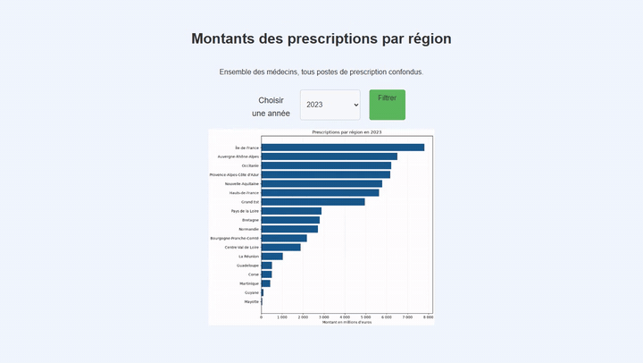

# Ameli - Exploration des données de l’Assurance maladie

Projet universitaire réalisé en équipe. L’application permet de consulter des données agrégées de l’Assurance maladie à partir d’une base SQLite.

- Filtrer les effectifs de professions de santé par région et profession.
- Rechercher et trier les prescriptions dans un aperçu de 200 lignes au maximum.
- Comparer les montants des prescriptions par région et par année.

**Outils :** Python, Flask, SQLite, pandas et Matplotlib.

## Aperçu du projet

L’aperçu utilise la base complète du projet.

[Image en grand format](docs/apercu.png) · [Voir la vidéo](docs/presentation.mp4)

## Télécharger et lancer

1. Installe [Python 3.14](https://www.python.org/downloads/) si besoin, en cochant **Add python.exe to PATH**.
2. [Télécharge le projet en ZIP](https://github.com/ArilesD/site-amelie/archive/refs/heads/main.zip), fais **Extraire tout**, puis ouvre le dossier extrait.
3. Double-clique sur **LANCER.cmd**.

Le premier lancement nécessite Internet pour installer les bibliothèques. Garde la fenêtre de lancement ouverte pendant l’utilisation et appuie sur **Entrée** dans cette fenêtre pour arrêter le projet.

La base est décompressée automatiquement au premier lancement et occupe environ 278 Mo. Le site s’ouvre sur le graphique régional : alterne entre **2022** et **2023** pour comparer les montants.

## Comprendre les fichiers

| Fichier ou dossier | Rôle |
| --- | --- |
| `LANCER.cmd` et `lancer.py` | Préparent et démarrent l’application. |
| `app.py` | Pages et filtres de l’application. |
| `model/` | Base de données et requêtes SQL. |
| `utils/graphiques.py` | Création des graphiques. |
| `templates/` et `static/` | Pages HTML et styles. |

Le [rapport universitaire](Rapport.pdf) et le [dépôt de conception de la base](https://github.com/ArilesD/database-amelie) présentent le travail de l’équipe.

## Sources et licence des données

La base archivée par l’équipe utilise les données agrégées de la Caisse nationale de l’Assurance Maladie (Cnam), diffusées par Data ameli sous licence [Open Database License 1.0](https://opendatacommons.org/licenses/odbl/1-0/). [Montants des prescriptions](https://data.ameli.fr/explore/assets/prescriptions/) · [Effectifs par mode d’exercice](https://data.ameli.fr/explore/dataset/demographie-exercices-liberaux/) · [Conditions de réutilisation](https://data.ameli.fr/terms/terms-and-conditions/)
