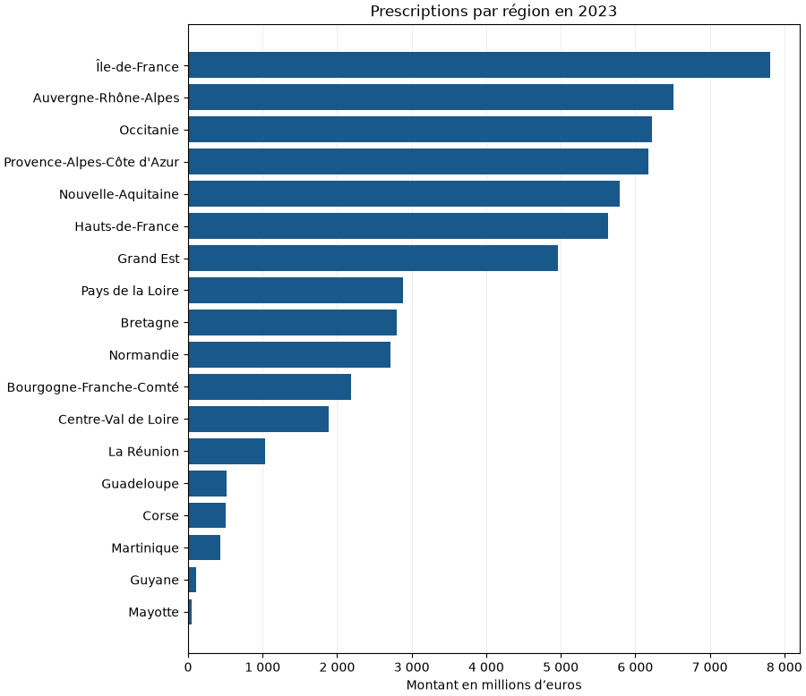

# Ameli - Application web d’exploration des données

Projet universitaire réalisé en équipe. Cette application Flask prolonge la [conception de la base Ameli](https://github.com/ArilesD/database-amelie). Elle permet d’explorer des données agrégées de l’Assurance maladie à partir d’une base SQLite.

- Filtrer les effectifs de professions de santé par région et profession.
- Rechercher des prescriptions dans un aperçu de 200 lignes au maximum et les trier par année.
- Visualiser le montant des prescriptions à l’aide de graphiques Matplotlib.

Le [rapport universitaire](Rapport.pdf) présente le travail de l’équipe. Les requêtes des graphiques et des effectifs utilisent les agrégats publiés au bon niveau.

## Aperçu du projet


Graphique des prescriptions : passage de 2023 à 2022 sur la base complète du projet.

[Voir la capture en grand format](docs/apercu.png) · [Voir la vidéo en grand format](docs/presentation.mp4) · [Mon parcours et mes autres projets](https://github.com/ArilesD)

## Télécharger et lancer

1. [Télécharge le ZIP complet](https://github.com/ArilesD/site-amelie/archive/refs/heads/main.zip).
2. Dans l’Explorateur Windows, fais **Extraire tout**, puis ouvre le dossier extrait.
3. Installe [Python 3.14](https://www.python.org/downloads/) si besoin, en cochant **Add python.exe to PATH**. Double-clique ensuite sur **LANCER.cmd**.

Le lancement extrait automatiquement la base complète conservée dans l’archive du projet, puis ouvre le graphique régional. Alterne entre 2022 et 2023 pour comparer les montants.

Garde la fenêtre de lancement ouverte pendant l’utilisation. Appuie sur **Entrée** dans cette fenêtre pour arrêter le projet. La première préparation des applications Python installe les bibliothèques depuis Internet. Les ouvertures suivantes réutilisent l’installation du dossier.

Sous macOS ou Linux avec Python 3.12 à 3.14, ouvre un terminal dans le dossier extrait et exécute **python3 lancer.py**.


## Explorer les données

La base complète du projet est fournie sous forme compressée dans le dossier model/data. L’application la décompresse automatiquement à la première ouverture. Elle occupe environ 278 Mo après extraction.



Depuis l’accueil, ouvre **Montants des prescriptions par région** et alterne entre 2022 et 2023. La carte des effectifs distingue les exercices libéraux exclusif et mixte.

### Lancement depuis le code

Avec Python 3.12 à 3.14, crée un environnement virtuel à la racine du dépôt.

```sh
python -m venv .venv
```

Active cet environnement puis exécute les commandes suivantes.

```sh
python -m pip install -r requirements.txt
python -m flask --app app run
```

Ouvre [l’application locale](http://127.0.0.1:5000). La préparation de la base est automatique.

## De la requête SQL au graphique

Pour comparer les régions sur un même périmètre, le graphique utilise la ligne du total régional déjà calculée pour l’ensemble des médecins et tous les postes de prescription. Le code départemental `999` identifie le niveau agrégé et le code régional `99` identifie la France entière.

```sql
SELECT r.libelle_region AS region,
       p.montant_total_prescription_integer AS montant_euros
FROM Prescriptions p
JOIN Regions r ON r.Id_Region = p.Id_Region
WHERE p.Annee = 2023
  AND p.Num_Departement = 999
  AND p.Profession_sante = 'Ensemble des médecins'
  AND p.poste_prescription = 'total'
  AND r.Id_Region <> 99
  AND typeof(p.montant_total_prescription_integer) = 'integer'
ORDER BY montant_euros DESC
```

La requête donne **7 814 970 581 €** pour l’Île-de-France en 2023. Le graphique affiche le même résultat en millions d’euros.

## Lire le code

| Fichier ou dossier | Rôle |
| --- | --- |
| `app.py` | Pages Flask, filtres et restitution des résultats. |
| `model/db.py` | Requêtes SQLite et chargement des résultats avec pandas. |
| `utils/graphiques.py` | Graphiques construits à partir des requêtes. |
| `templates/` et `static/` | Pages HTML et styles. |

## Sources et licence des données

La base archivée par l’équipe utilise les données agrégées de la Caisse nationale de l’Assurance Maladie (Cnam), diffusées par Data ameli sous licence [Open Database License 1.0](https://opendatacommons.org/licenses/odbl/1-0/). [Montants des prescriptions](https://data.ameli.fr/explore/assets/prescriptions/) · [Effectifs par mode d’exercice](https://data.ameli.fr/explore/dataset/demographie-exercices-liberaux/) · [Conditions de réutilisation](https://data.ameli.fr/terms/terms-and-conditions/)
