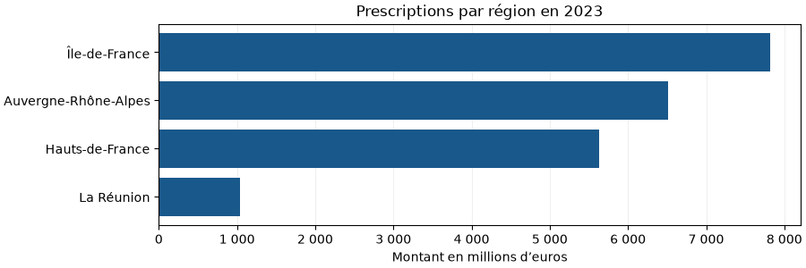

# Ameli - Application web d’exploration des données

Projet universitaire réalisé en équipe. Cette application Flask prolonge la [conception de la base Ameli](https://github.com/ArilesD/database-amelie). Elle permet d’explorer des données agrégées de l’Assurance maladie à partir d’une base SQLite.

- Filtrer les effectifs de professions de santé par région et profession.
- Rechercher des prescriptions dans un aperçu de 200 lignes au maximum et les trier par année.
- Visualiser le montant des prescriptions à l’aide de graphiques Matplotlib.

Le [rapport universitaire](Rapport.pdf) présente le travail de l’équipe. Pour le portfolio, une base légère a été préparée à partir de la base d’origine et les requêtes des graphiques et des effectifs ont été précisées pour utiliser les agrégats publiés au bon niveau.

## Essayer la démonstration

La base incluse dans `demo/` pèse **68 Kio**. Elle couvre les prescriptions de 2022 et 2023 ainsi que les effectifs de 2023 pour quatre régions de la base du projet. Le graphique national utilise les montants moyens déjà calculés pour la France entière. La carte des effectifs distingue les exercices libéraux exclusif et mixte.



Avec Python 3.12, crée un environnement virtuel à la racine du dépôt.

```sh
python -m venv .venv
```

Active-le avec `.\.venv\Scripts\Activate.ps1` sous Windows PowerShell ou `source .venv/bin/activate` sous macOS et Linux. Installe ensuite les dépendances et lance le site.

```sh
python -m pip install -r requirements.txt
python -m flask --app app run
```

Depuis [l’accueil de la démonstration](http://127.0.0.1:5000), ouvre « Montants des prescriptions par région » et alterne entre 2022 et 2023. Le site choisit l’extrait automatiquement quand la base complète est absente.

## De la requête SQL au graphique

Pour comparer les régions sur un même périmètre, le graphique utilise la ligne du total régional déjà calculée pour l’ensemble des médecins et tous les postes de prescription. Le code départemental `999` identifie le niveau agrégé et le code régional `99` identifie la France entière.

```sql
SELECT r.libelle_region AS region,
       p.montant_total_prescription_integer AS montant_euros
FROM Prescriptions p
JOIN Regions r ON r.Id_Region = p.Id_Region
WHERE p.Annee = 2023
  AND p.Num_Departement = 999
  AND p.Profession_sante = 'Ensemble des médecins'
  AND p.poste_prescription = 'total'
  AND r.Id_Region <> 99
  AND typeof(p.montant_total_prescription_integer) = 'integer'
ORDER BY montant_euros DESC
```

Dans l’extrait, la requête donne **7 814 970 581 €** pour l’Île-de-France en 2023. Le graphique affiche le même résultat en millions d’euros.

Pour régénérer l’extrait à partir de la base extraite, exécute `python demo/creer_extrait.py model/data/debase_db.sqllite3 chemin/vers/nouvel-extrait.sqlite`. Les montants et les effectifs sont conservés tels qu’ils figurent dans la base du projet.

## Utiliser la base complète

Une fois les dépendances installées, prépare la base et lance Flask.

```bash
python prepare_data.py
python -m flask --app app run
```

Ouvre [http://127.0.0.1:5000](http://127.0.0.1:5000). La préparation extrait la base SQLite d’environ 278 Mo depuis `site-amelie.zip`, disponible dans le [dépôt GitHub](https://github.com/ArilesD/site-amelie). Si la base complète est présente, le site l’utilise en priorité.

## Lire le code

| Fichier ou dossier | Rôle |
| --- | --- |
| `app.py` | Pages Flask, filtres et restitution des résultats. |
| `model/db.py` | Requêtes SQLite et chargement des résultats avec pandas. |
| `utils/graphiques.py` | Graphiques construits à partir des requêtes. |
| `templates/` et `static/` | Pages HTML et styles. |

## Sources et licence des données

L’extrait SQLite est dérivé de la base archivée par l’équipe, à partir des données agrégées de la Caisse nationale de l’Assurance Maladie (Cnam), diffusées par Data ameli. Les données de l’extrait sont mises à disposition sous la licence [Open Database License 1.0](https://opendatacommons.org/licenses/odbl/1-0/). [Montants des prescriptions](https://data.ameli.fr/explore/assets/prescriptions/) · [Effectifs par mode d’exercice](https://data.ameli.fr/explore/dataset/demographie-exercices-liberaux/) · [Conditions de réutilisation](https://data.ameli.fr/terms/terms-and-conditions/)
